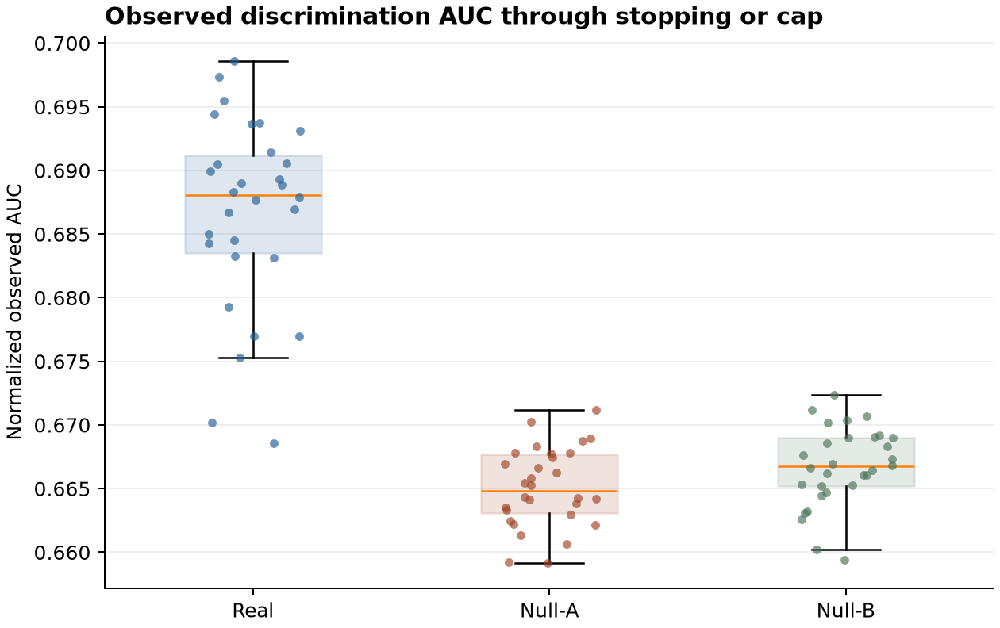
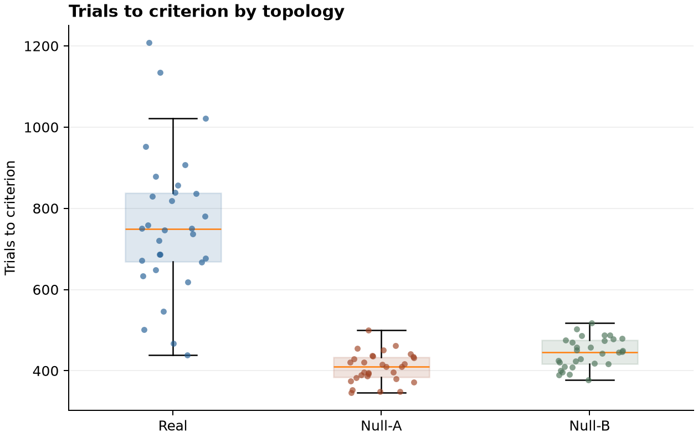
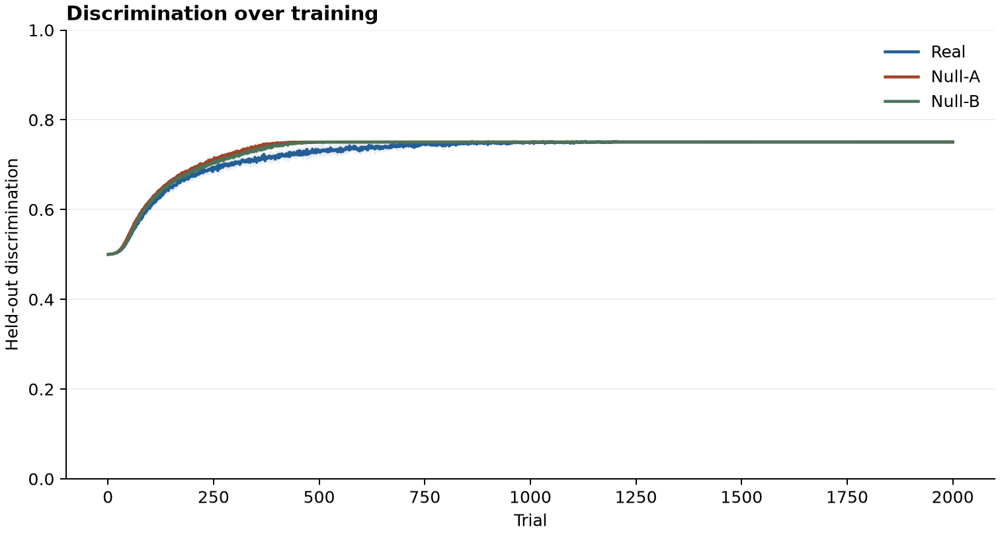
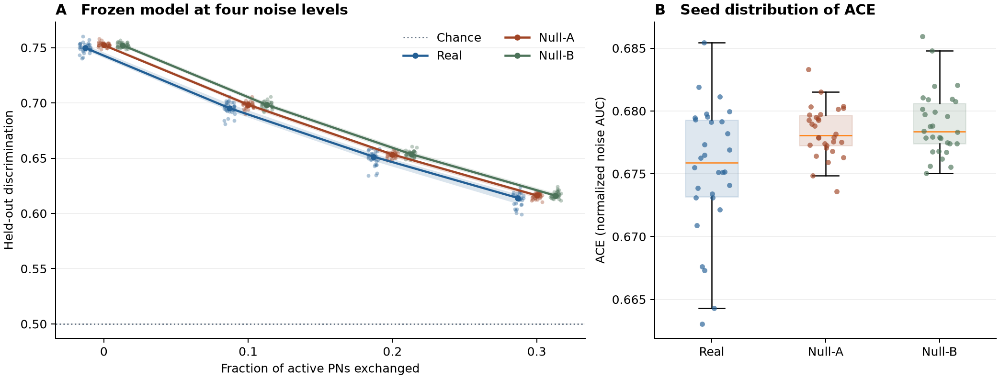

# Confirmatory results

Analysis started at **2026-11-19T13:06:55.209086+03:30** (Tehran). Verified 1,830 fresh jobs in 305 archives. The registered primary used [AMENDMENT-02](https://github.com/samyarvahabzadeh/flywire-mb-gnn-topology-bias/blob/v1.2-prereg-amendment/AMENDMENT-02.md).

## Descriptive checks

The data passed the frozen matrix, receipt, archive, Parquet and registered-endpoint checks. The six rate-benchmark jobs were outside the eligible inventory. For display, a capped miss is placed at trial 2,000. The seed summaries use one real run or the within-seed median for the relevant null variant.

| Condition | Jobs | Seed groups | Job TTC median [Q1, Q3] | Seed TTC median [Q1, Q3] | Right-censored | Observed hits at cap |
| --- | ---: | ---: | ---: | ---: | ---: | ---: |
| Real | 30 | 30 | 748.50 [668.25, 838.25] | 748.50 [668.25, 838.25] | 0 | 0 |
| Null-A | 900 | 30 | 404.00 [335.00, 496.25] | 410.00 [383.75, 433.50] | 1 | 0 |
| Null-B | 900 | 30 | 441.00 [362.00, 552.25] | 445.75 [417.12, 474.88] | 0 | 0 |

All observed TTC values were within trials 20–2,000. The table preserves every cap event. No data were removed or modified.

Discrete clean AUC is normalized by each job's observed trial count through stopping or cap. Each point is a seed summary.

Each point is one of 30 seed summaries per condition. A censored job is displayed at its observed cap.

Lines average 30 seed summaries and bands show the inter-seed IQR. Curves after early stop carry forward each job's terminal 20-trial mean.

Points, medians and IQRs are based on 30 seed summaries per condition. Null values are within-seed medians. Panel B summarizes job ACE values at the seed level.

## Primary TTC analysis

The analysis pairs each real TTC with the median TTC of its 60 null jobs. A capped miss receives rank value 2,001. A positive difference favors the real graph. The one-sided Wilcoxon upper tail uses the exact sign distribution of midranks with zero pairs dropped. The 95% rank-biserial interval is a percentile bootstrap over 30 paired seeds with 10,000 draws and seed 20261119.

| Null comparator | Paired seeds | Nonzero | Real median | Median of seed null medians | Median null − real | W+ | p | Rank-biserial r [95% CI] |
| --- | ---: | ---: | ---: | ---: | ---: | ---: | ---: | ---: |
| Pooled nulls | 30 | 30 | 748.50 | 424.00 | -318.75 | 2.0 | 1 | -0.9914 [-1.0000, -0.9484] |

## Requested stratified secondary comparisons

The v1.2 plan specifies descriptive reporting by null variant. The researcher-requested Wilcoxon rows below were locked before inspecting outputs and are supplementary to the registered primary test and three-outcome BH family.

| Null comparator | Paired seeds | Nonzero | Real median | Median of seed null medians | Median null − real | W+ | p | Rank-biserial r [95% CI] |
| --- | ---: | ---: | ---: | ---: | ---: | ---: | ---: | ---: |
| Null-A | 30 | 30 | 748.50 | 410.00 | -340.25 | 1.0 | 1 | -0.9957 [-1.0000, -0.9742] |
| Null-B | 30 | 30 | 748.50 | 445.75 | -299.50 | 2.0 | 1 | -0.9914 [-1.0000, -0.9484] |

## Secondary outcomes and BH correction

Each row pairs the real outcome with the median over all 60 matched nulls. Smaller first-crossing values favor real and missing first crossings receive rank value 2,001. Larger AUC and ACE favor real in the effect-size convention. The first two tests follow the one-sided v1.2 directions. ACE uses a two-sided exact signed-rank test. The researcher replaced the registered noise slope with ACE after data generation and before outcome inspection. ACE is the normalized trapezoid `(d0 + 2*d0.1 + 2*d0.2 + d0.3)/6`. Benjamini–Hochberg correction is applied to these three tests.

«عملیاتی‌سازی ACE پیش از اجرای آمار استنباطی فیکس شد.»

| Outcome | Tail | Paired seeds | Nonzero | Real median | Median of seed null medians | W+ | Raw p | BH-adjusted p | r |
| --- | --- | ---: | ---: | ---: | ---: | ---: | ---: | ---: | ---: |
| First single crossing ≥0.75 | greater | 30 | 30 | 437 | 320.5 | 4.0 | 1 | 1 | -0.9828 |
| Normalized AUC to cap | greater | 30 | 30 | 0.727662 | 0.732816 | 2.0 | 1 | 1 | -0.9914 |
| ACE | two-sided | 30 | 30 | 0.675883 | 0.678362 | 89.0 | 0.00236749 | 0.00710248 | -0.6172 |

Each bootstrap draw resamples whole matched seeds and recomputes signed ranks. The interval conditions on the generated bank of null graphs. [Wilcoxon reference](https://docs.scipy.org/doc/scipy/reference/generated/scipy.stats.wilcoxon.html) · [BH reference](https://docs.scipy.org/doc/scipy/reference/generated/scipy.stats.false_discovery_control.html)

## Reproducibility

- Analysis commit `ef2eb2f95d73b118390aca13e9ad5f0a745cc2ae`
- Analysis script SHA-256 `7dd96613c9b8de044bf03d2ea2eda7341067620bd3769fd27de9d30946c4ba67`
- Frozen data plan SHA-256 `149776bcf90f9d2a9ce5455d1c6e9b2cf2b97f8f9e1d56d76b7828121f6ee23f`
- Drive completion marker SHA-256 `472c452f40c4c11bad83ce6d3c10e44d8dffebf452f3e6d0765f862479567f68`
- Verified receipt sequence SHA-256 `2b796ff309f772110f44665b6300a2e76c6f7d64d1bdd77df2b9eee3e7ce1795`
- Full helper hashes, versions and tables in [analysis-summary.json](analysis-summary.json).
